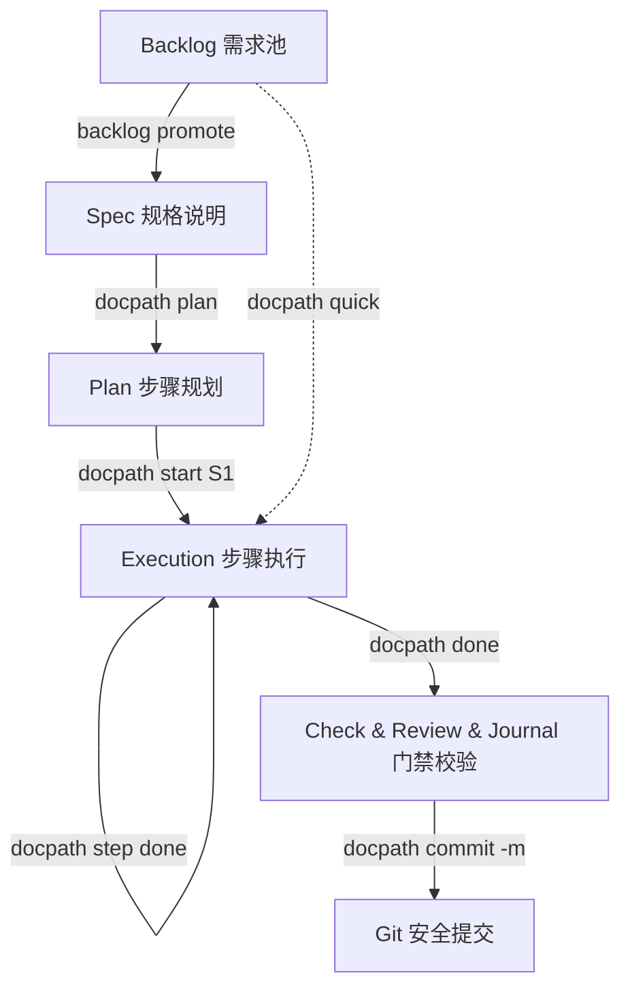

# 文径 DocPath — 渐进式文档驱动工作流 (Document as Finite State Machine)

DocPath 是一款专为**大模型 Agent（以及人类开发者）**设计的结构化任务状态机与工作流管理 CLI 工具。它将开发任务抽象为有限状态机（FSM），通过 Markdown 文档（Backlog、Spec、Plan）和严格的阶段门禁（Check、Review、Journal），指导并规范 Agent 从“需求分析”到“安全提交”的完整生命周期，从根本上防止 Agent 发生幻觉、偏离目标或污染代码库。

---

## 🌟 核心理念与设计原则

*   **文档与结构化状态共同驱动 (Document + Structured State as FSM)**：任务的每一步进展（如计划生成、步骤认领、门禁校验）都会同步到任务文档和结构化 JSON/JSONL 状态文件中；JSON/JSONL 是机器真源，Markdown 是人类可读视图或叙事任务文档。
*   **Agent 友好与 CLI 优先**：支持通过 `--agent` 输出紧凑、高信噪比的 YAML 数据，完美融入 Agent 的观察与决策循环。
*   **门禁与效率的完美平衡**：
    *   **标准铁轨工作流**：适用于复杂、涉及架构调整的研发，拥有极其严苛的 Spec、Plan、Check 和 Review 门禁序列。
    *   **微型任务快车道**：提供 `docpath quick` 命令，对拼写纠正、极低风险的 Bugfix 自动简化，免除 Spec/Plan 编写，同时守住 Check 质量底线。
*   **安全防线 (Fail-Safe)**：底层内置严密的 Git 安全检测（防脱水 HEAD、防冲突、防重要源码未追踪漏交）与运行时状态锁，保证多人协作或多分支并发时的安全。

---

## 🏗️ 渐进式状态流转图



---

## 🛠️ 安装与快速上手

### 1. 本地安装与链接
在 DocPath 项目目录下构建并全局挂载：

```bash
pnpm install
pnpm run build
pnpm link --global
docpath --help
```

### 2. 初始化项目
在需要管理的项目目录下运行：

```bash
# 交互式初始化（适合人类）
docpath init --interactive

# 非交互式初始化（适合 CI / 脚本 / Agent）
docpath init --level 2
```

---

## 💻 常用命令与核心工作流

### 🚂 场景 A：标准开发任务（以 R-190 需求为例）

#### 第一阶段：需求明确与计划 (Define & Plan)
1. **领取并接管任务**：
   ```bash
   # 从 backlog 中提升并绑定任务 ID
   docpath backlog promote R-190
   # 声明 Agent 进入该任务
   docpath agent enter
   ```
2. **编写设计规范 (Spec) 与计划 (Plan)**：
   * 编写你的 `spec.md` 说明设计边界。通过后写入：`docpath write-spec --stdin`
   * 根据 Spec 自动生成计划大纲：`docpath plan`
   * 确认计划后持久化：`docpath write-plan --stdin`

#### 第二阶段：执行与追踪 (Execute & Track)
1. **启动第一个步骤**（内部会自动触发 atomic step 声明）：
   ```bash
   docpath start S1
   ```
2. **编码开发并同步进度**（支持自动推断当前活跃步骤）：
   ```bash
   # 完成当前子任务
   docpath step done
   # 或者若遇到卡点，标记为阻塞并寻求恢复
   docpath step blocked
   docpath recover S1
   ```

#### 第三阶段：门禁、归档与提交 (Closeout & Commit)
1. **一键跑通检查与经验归档**（串联 `check` -> `review` -> `journal` 门禁序列）：
   ```bash
   docpath done
   ```
   > 开发期想省时间可单独跑 `docpath check --test-scope=touched`——按**本次 git 改动**跑相关测试。改到叶子工具/独立模块时有明显加速（如只跑 backlog 相关 3 个测试文件：~80s 全量 → ~14s）；改到顶层命令主文件（`src/commands/*.ts`）、`src/engine`、`src/commands/check`、共享核心 utils 或 `package.json` 时**自动回落全量**，绝不因减载漏测核心。`--test-scope=full` 保留全量但注入受控并发与进程隔离，消除共享 sqlite 竞态偶发失败。最终收口仍由 `docpath done` 跑全量门禁兜底。
2. **安全提交**（自动检查 Git 安全，过滤 `.docpath/` 运行时噪音，强制 force-add 需要版本化的 canonical 任务证据，并自动带上 Agent 协作签名）：
   ```bash
   docpath commit -m "feat: implement feature based on R-190"
   ```

---

### ⚡ 场景 B：微型任务快车道 (Fast Track)

当仅需做极小改动（如修改拼写错误或文档）时，你可以跳过重型的规划：

```bash
# 1. 启动轻量任务（跳过 Spec/Plan）
docpath quick "Fix typo in CLAUDE.md"

# 2. 修改文件...

# 3. 闭环（自动跑 check，自动跳过 review，记录 journal）
docpath done

# 4. 安全提交
docpath commit -m "docs: fix typo in claude docs"
```

---

### 🌿 场景 C：Worktree 并发开发 (Concurrent Development)

如果需要多个 Agent 或开发进程在同一个仓库内不产生状态文件（`state.json`）冲突地并行开发不同的任务：

```bash
# 1. 创建并进入独立工作树
docpath worktree create feature-payment
cd .worktrees/feature-payment

# 2. 设置 Session ID 区分轨迹（推荐）
export DOCPATH_SESSION=claude-payment

# 3. 像往常一样开发
docpath backlog promote R-191
docpath agent enter
...
docpath done
git commit

# 4. 合并并清理
cd ../../
git merge feature-payment
docpath worktree remove feature-payment
```

---

## 📁 目录结构与隔离机制

在 DocPath 项目中，`.docpath/` 目录下各文件夹分工明确：

*   **共享资源**（即便在 worktree 并发模式下也全局共享）：
    *   `.docpath/backlog/`：全局需求池，承载 `backlog.md` 等待领任务。
    *   `.docpath/rules/`：全局架构规范和编码准则。
*   **隔离/运行时资源**（在 worktree 下独立，防止状态冲突）：
    *   `.docpath/workspace/`：保存当前会话的 `state.json`、`breadcrumb.jsonl` 等机器真源，以及 `current.md`、`breadcrumb.md` 等人类渲染视图。
    *   `.docpath/tasks/`：每个任务各自的 spec、plan 以及交付物归档。
*   **Git 提交控制**：
    *   整个 `.docpath/` 在 `.gitignore` 中默认被忽略。
    *   通过 `docpath commit` 提交时，系统会**只提取并 force-add** 保存在 `.docpath/tasks/done/T-xxx/` 下的 canonical 任务证据，将其他运行时文件完美排除在代码历史之外。

---

## 📖 常用命令速查

| 命令分类 | 命令 | 作用与机制 |
| :--- | :--- | :--- |
| **基础运维** | `docpath init` | 初始化项目，可指定级别 `--level 0-3` |
| | `docpath status --agent` | 诊断工作流状态、漂移度及 install 健康度 |
| | `docpath next --agent` | 获取只读的下一步路由建议与任务上下文建议 |
| **日常执行** | `docpath start <step>` | 启动或认领一个 Plan 步骤 (推荐) |
| | `docpath step done` | 完成当前活跃步骤（自动推断，不需传参） |
| | `docpath step blocked` | 标记当前活跃步骤被阻塞 |
| | `docpath done` | 完成整个任务（依次调用 check -> review -> journal） |
| **错误恢复** | `docpath recover <step>` | 从 blocked 状态中恢复并重置当前步骤 |
| | `docpath retry <step>` | 重新认领并尝试一个 skipped 步骤 |
| **收尾提交** | `docpath commit --dry-run` | **默认行为**，预览本次提交包含的常规代码与 canonical 证据 |
| | `docpath commit --stage` | 仅做 Staging 操作，自动 force-add 忽略但在 Git 追踪内的文件 |
| | `docpath commit -m "msg"`| Staging 并创建 Commit，自动追加 Agent Co-Author 信息 |
| **并发开发** | `docpath worktree list` | 列出当前项目下的全部工作树及活跃 Task 状态 |
| | `docpath worktree create` | 创建独立的 Git Worktree 隔离开发环境 |
| | `docpath worktree remove` | 删除指定的 Git Worktree（防脏代码，未提交时拒绝删除） |
