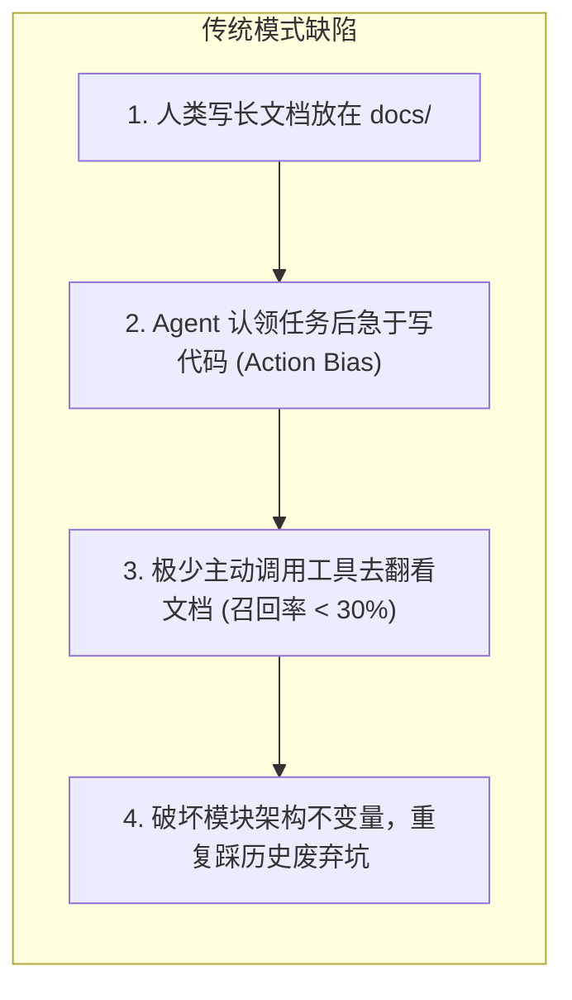

---
related:
  - design/agent-integration.md
---

# Agent 零点击上下文随路注入与智能路由体系架构

> **定位**：解决 Agent 辅助编程中的「行动偏差（Action Bias）」、「上下文爆炸（Token Bloat）」与「架构红线违背（Invariant Breaking）」三大核心难题，确保架构共识与历史踩坑经验 100% 确定性触达 Agent。

---

## 一、 问题背景与设计动因 (Problem Statement)

在多 Agent 协同与单 Agent 深度编码实践中，传统的“将规范写入文档并期望 Agent 自发查阅”模式存在严重的工程缺陷：



### 1. 核心痛点
1. **行动偏好（Action Bias）与额外往返成本**：
   Agent 在认领步骤后，最直接的目标是调用代码编辑工具。若在“认领步骤”与“写代码”之间强制要求 Agent 自发调用查询命令，既增加了额外的网络与 Tool Call 往返延迟，又容易因 Prompt 注意力衰减被忽略。
2. **上下文膨胀与注意力稀释（Context Bloat）**：
   若 Agent 遇到疑惑时直接使用全量文件读取工具（如查看 `current.md`、`spec.md` 或全量 `docs-index.json`），一次调用便耗费 20,000+ Tokens，极大增加了幻觉概率与 API 成本。
3. **架构不可变不变量（Invariants）被反复破坏**：
   底层核心模块（如 `src/engine/` 状态机、`src/utils/worktree.ts` 隔离模型）经历过多轮历史 ADR 决策。新进 Agent 缺乏局部记忆，极易重新写出已被废弃的方案（例如为 Worktree 添加 Symlink 导致 Git 冲突）。

---

## 二、 三层防御架构 (Three-Tier Defense Architecture)

DocPath 放弃了“依赖 Agent 自觉查阅”的虚假假设，转而采用**「零点击随路下发 + 状态机强约束 + 按需切片兜底」**的三层防御模型：

```mermaid
flowchart TD
    subgraph Tier1["Tier 1: 零点击随路下发 (Zero-Click In-Band Injection) — 100% 确定性"]
        A["Agent 执行 docpath next 或 docpath go --step"] --> B["CLI 内部上下文引擎 (context-injection)"]
        B --> C["提取与当前模块相关的 2~3 条 ADR 决策与核心负面清单 (< 500 Tokens)"]
        C --> D["直接嵌入 next/go 输出的 context_injection 字段"]
        D --> E["⚡ Agent 无需额外操作，上下文已天然具备红线约束"]
    end

    subgraph Tier2["Tier 2: 状态机与门禁强提示 (State-Machine Driven Guidance) — 80% 遵从率"]
        F["触及高危路径或门禁检查失败 (docpath check fail)"] --> G["CLI 输出显式 recommended_command: docpath context --smart"]
        G --> H["Agent 遵循 next 路由器建议，发起单次精准规则查询"]
    end

    subgraph Tier3["Tier 3: 按需自愈与防爆炸隔离 (On-Demand Budgeted Fallback) — 兜底通道"]
        I["长会话上下文被平台截断 / 深度背景缺失"] --> J["Agent 遵守 AGENTS.md 规则，使用 docpath context --smart 替代长文档"]
        J --> K["获取 < 2000 Tokens 预算的局部上下文切片"]
    end
```



---

## 三、 机制核心实现 (Implementation Details)

### 1. 随路注入契约 (In-Band Injection Contract)
在 `docpath next --agent` 和 `docpath go` 的返回结构体中，`context_injection` 字段作为紧凑的结构化元数据常驻：

```yaml
agent_view: next
state: executing
context_injection:
  spec_summary:
    title: T-20260923-agent - Agent 零点击上下文随路注入与智能路由体系完善
    requirements:
      - Agent 零点击上下文随路注入与智能路由体系完善
  recent_decisions:
    - id: ADR-20260923-005
      category: risk.escalation
      conclusion: check 风险复评升级 R2 → R3
    - id: ADR-20260923-004
      category: worktree.isolation
      conclusion: 严禁对 tracked 目录使用 symlink，采用 branch merge-mediated 隔离模型
```

### 2. 局部关联匹配算法 (Affinity Matching Algorithm)
随路注入与 `docpath context --smart` 共用上下文评分器：
1. **路径亲和性（Path Affinity）**：分析当前 Git 状态或准备改动的文件路径，计算与 `.docpath/rules/` 中规则文件的重合度。
2. **关键词与 ADR 决策关联（Decision Relevance）**：从 `decisions.jsonl` 中过滤出与当前模块名称、Task Title 重合度最高的 ADR 结论。
3. **严格 Token 熔断（Hard Budget Clamping）**：
   - 随路注入控制在 **300~500 Tokens**。
   - `docpath context --smart` 单次包控制在 **1000~2000 Tokens** 以内。

---

## 四、 核心场景使用指引与心智模型

| 工具 / 命令 | 角色定位 | Token 预算 | 触发方式 | Agent 认知模型 |
| :--- | :--- | :--- | :--- | :--- |
| **`docpath next --agent`** | **总指挥 / 导航仪** | ~200 Tokens | 会话开始 / 步骤结束 | “我现在该做什么？下一步调用什么命令？” |
| **`docpath go --step` 随路注入** | **防错护栏 / 实时红线** | ~300 Tokens | 认领步骤时由 CLI 随路注入 | “针对我当前步骤，有哪些不可违反的架构决策？”（零点击） |
| **`docpath context --smart`** | **局部自愈 / 避坑雷达** | 300~1000 Tokens | 门禁报错 / 会话截断恢复时手动调用 | “我需要更详细的局部规则，但严禁翻看长文档” |
| **`docpath reveal --topic`** | **放大镜 / 专题深入** | 500~2000 Tokens | 遇到深层架构疑难时定向使用 | “针对这个特定技术主题，设计背景和全貌是什么？” |

---

## 五、 协议硬约束 (AGENTS.md Protocol Invariants)

为了保证整套机制不被破坏，所有接入 DocPath 的 Agent 均必须遵守以下协议不变量：

1. **严禁越级翻看完整渲染 Markdown**：禁止使用文件读取工具全量读取 `current.md`、`breadcrumb.md`、`docs-index.json`。
2. **必须以随路 context_injection 为准**：在开始修改代码前，优先检查 `next` / `go` 返回中的 `recent_decisions` 与 `spec_summary`。
3. **自愈优先使用智能切片**：当上下文丢失或需要排查规则冲突时，必须使用 `docpath context --smart` 或 `docpath reveal`，不得进行全仓扫描。

---

## 六、 演进与维护

- **决策沉淀入口**：通过 `docpath journal` 记录的 ADR 决策，会自动同步至 `decisions.jsonl`，成为随路注入的数据源。
- **规则提炼入口**：通过 `docpath learn` 提炼的 Gotcha 规则，会自动入库到 `.docpath/rules/`，供路径亲和性算法即时命中。
