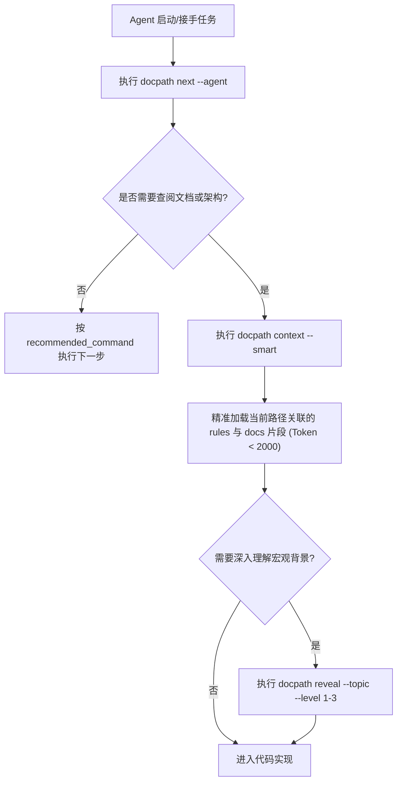

---
related:
  - design/project-document-placement.md
  - design/refactor-doc-management-plan.md
---

# DocPath 文档全生命周期管理规范与演进体系

> 本规范定义 DocPath 及其衍生工程项目的**文档全生命周期管理体系**，确保架构文档、决策记录（ADR）、活项目文档与任务经验与代码变更**同频演进、长期保鲜、双向可追溯**。
>
> 最终目标：使任何新加入的开发者或后续 AI 编码助手（Agent）仅通过阅读项目文档资产，即可**高精度还原项目自诞生以来的完整演进时间线、关键决策取舍与当前系统架构**。

---

## 一、 文档体系全景分层 (Documentation Architecture)

DocPath 采用 **4 层文档资产分层模型**，明确每一类文档的定位、格式、更新时机与消费方式：

```
项目根目录/
├── docs/                                 # 【第二层：系统活项目文档 (Living Project Docs)】
│   ├── README.md                         # 文档中心总索引 (Human & Agent 阅读入口)
│   ├── architecture/                     # 系统宏观架构、核心机制、分层契约
│   │   ├── system-overview.md            # 系统全景架构与数据流 (C4 模型)
│   │   └── documentation-lifecycle-guide.md # 本规范真源
│   ├── features/                         # 核心业务模块与特性说明
│   ├── design/                           # 深度设计提案与技术方案 (Design Proposals)
│   ├── workflows/                        # 工作流、门禁与工件策略
│   ├── integrations/                     # 多平台/多 Agent 协议适配指南
│   ├── getting-started.md                # 快速上手指南
│   ├── product-panorama.md               # 产品全景能力矩阵
│   └── error-codes.md                    # 错误码字典与排障手册
│
├── .docpath/
│   ├── rules/                            # 【第一层：实时规则与硬约束 (Realtime Rules & Gotchas)】
│   │   ├── style.md                      # 代码规范与命名约定
│   │   ├── architecture.md               # 架构边界、依赖方向与防腐规则
│   │   └── gotchas.md                    # 踩坑库与防错指南 (由经验沉淀持续补充)
│   │
│   ├── backlog/                          # 【第三层：需求演进池 (Requirement Backlog)】
│   │   ├── backlog.md                    # 活跃需求索引
│   │   ├── R-###-slug.md                 # 单需求卡片 (含 Decision Brief / Evidence 锚点)
│   │   ├── analysis/                     # 需求前置分析、调研报告与决策草案
│   │   └── archived/                     # 终态需求历史归档 (done / dropped)
│   │
│   ├── workspace/                        # 【第四层：运行状态与决策日志 (Runtime & Decision Log)】
│   │   ├── decisions.md                  # 当前活跃 ADR 决策日志 (热区)
│   │   └── decisions-YYYY-MM.md          # 按月轮转的历史 ADR 归档库 (冷区)
│   │
│   ├── tasks/done/                       # 【第四层：任务执行审计快照 (Task Audit Archive)】
│   │   └── T-YYYYMMDD-slug/              # 任务全套工件 (spec.json, plan.json, journal.md, breadcrumb.jsonl)
│   └── docs-index.json                   # 机器可读活文档索引 (供 Agent 上下文精准路由)
```

---

## 二、 核心文档类别与生命周期规范

### 1. 架构文档 (Architecture Documentation)

* **存放位置**：`docs/architecture/`
* **内容规范**：
  - **分层与模块边界**：明确各目录与模块职责，声明单向依赖关系与禁止跨层调用的边界。
  - **数据流与核心时序**：使用标准 Mermaid 图（`flowchart TD` / `sequenceDiagram`）绘制关键执行链路。
  - **核心模型与状态机**：阐明状态转移合法矩阵（如 FSM）及一致性校验安全阀。
* **更新触发时机**：
  1. 引入新模块、重构核心目录结构或改变模块间调用契约时；
  2. 状态机模型、跨进程共享模型（如 Git Worktree 共享层）发生调整时；
  3. 更改 CLI 核心命令面或对外核心 API 时。
* **修订同步机制**：
  - 在任务的 `plan.md` 中必须包含「更新对应架构文档」的独立步骤。
  - 任务收尾门禁 `docpath review` / `docpath done` 时，自动对比 `changed_files` 是否涉及核心路径，提示并确保 `docs/architecture/` 相应修订已就绪。

---

### 2. 决策文档 (Architecture Decision Records - ADR)

* **存放与生命周期流转**：
  - **酝酿期**：在需求调研阶段，记录于 `.docpath/backlog/analysis/R-xxx-decision-brief.md`，经用户/团队确认；
  - **生效期（热区）**：任务执行并合入后，决策通过 `docpath journal` 自动萃取写入 `.docpath/workspace/decisions.md`；
  - **归档期（冷区）**：每月初由 `docpath journal` 自动轮转至 `.docpath/workspace/decisions-YYYY-MM.md`，保持热区轻量；
  - **永久追溯**：每个任务目录 `.docpath/tasks/done/<taskId>/` 中永久保留该任务维度的决策快照。

* **标准 ADR 格式模板 (MADR 规范)**：

```markdown
### ADR-YYYYMMDD-###: [简明决策标题]

- **状态**: Accepted | Superseded by ADR-xxx | Deprecated
- **关联需求/任务**: Backlog R-### / Task T-YYYYMMDD-slug
- **决策时间**: YYYY-MM-DD
- **上下文与问题 (Context)**: 
  当前遇到了什么痛点、架构冲突或技术限制？为什么现存方案无法满足要求？
- **决策方案 (Decision)**: 
  我们决定采取什么方案（如：采纳方案 B）？核心设计是什么？
- **决策理由 (Rationale)**: 
  为什么选择该方案？解决了哪些关键矛盾？
- **后果与权衡 (Consequences)**:
  - 收益 (+): 带来了什么性能提升、易用性收益或架构解耦？
  - 代价 (-): 引入了哪些妥协、维护成本或边界限制？
- **备选方案 (Alternatives Considered)**:
  - 方案 A: 为什么未采纳？
  - 方案 C: 为什么未采纳？
- **用户/架构确认**: 记录确认时间、确认人及重要限定条件。
```

---

### 3. 文档命名规则与代码双向关联机制

* **命名规范**：
  - 统一采用 **小写字母 + 连字符（kebab-case）**，严禁使用空格、下划线或非标准特殊字符。
  - 需求文件：`R-###-<slug>.md`（如 `R-356-worktree-backlog-sync.md`）。
  - 分析文件：`R-###-<topic>-analysis.md` / `R-###-decision-brief.md`。
  - 任务目录：`T-YYYYMMDD-<slug>`。
  - 活文档：`docs/<category>/<topic>.md`。

* **文档与代码提交（Git Commit）双向关联**：
  1. **提交信息规范**：每次代码提交的 Header 与 Body 必须显式引用任务与 Backlog 编号：
     ```gitcommit
     feat(backlog): 引入 cleanBacklogTitle 标题自动降噪机制 (R-368)
     
     - 剥离前置 P0/P1/R-### 冗余标记，保持文件名自描述
     - 关联任务: T-20260923-backlog-title-cleanup
     - 决策记录: ADR-20260923-006
     - 活文档更新: docs/architecture/documentation-lifecycle-guide.md
     ```
  2. **自动化收尾组装**：通过 `docpath changes --agent` 或 `docpath done --commit`，CLI 会自动根据当前 task spec、通过的 check 门禁和 ADR 自动生成符合规范的提交说明，杜绝口径脱节。

---

## 三、 AI 编码助手（Agent）智能引导与文档消费协议

为防止 Agent「盲目修改代码」或「无脑全量读取文档造成上下文爆炸」，DocPath 建立了 **三级渐进式 Agent 引导协议**：



### 1. 引导机制操作守则
1. **全局总索引入口**：`docs/README.md` 是人类与 Agent 查阅项目文档的唯一顶层目录，列出各类文档的用途、推荐阅读路径。
2. **智能上下文注入（Smart Routing）**：
   - Agent **严禁** 直接全量读取大型 Markdown 文件（如 `current.md`, `spec.md`, `docs-index.json`）。
   - 必须优先使用 `docpath context --smart`（按修改文件路径关联路由）或 `docpath context --max-tokens 2000 --topic <topic>` 提取切片。
3. **架构深度展开**：当涉及复杂跨模块逻辑时，通过 `docpath reveal --topic <keyword> --level 1-3` 渐进式按需展开深度设计。

---

## 四、 知识沉淀与回写闭环流程 (Knowledge Back-propagation)

每一次代码迭代绝非在代码合入后即告结束，必须执行标准**知识回写闭环**：

| 沉淀类型 | 触发场景 | 回写目标位置 | 工具/命令支持 |
| :--- | :--- | :--- | :--- |
| **避坑指南 (Gotchas)** | 解决了一个隐蔽 Bug、踩了第三方库或环境特性的坑 | `.docpath/rules/gotchas.md` | `docpath quick-done --gotcha "..."` 或 `docpath learn` |
| **架构决策 (ADRs)** | 涉及方案选型、技术栈取舍、破坏性改动 | `.docpath/workspace/decisions.md` | `docpath journal` |
| **产品/接口变更** | 调整了对外命令、API 参数、产品工作流 | `docs/` 对应模块文档 | 手动更新 + `docpath docs sync` |
| **通用经验 (Lessons)** | 提炼出通用的编码模式、架构模式 | `.docpath/rules/*.md` | `docpath learn --promote` |

---

## 五、 文档长期保鲜与防腐化审计机制 (Anti-rotting Engine)

为防止文档随时间推移出现「链接失效、幽灵索引、内容与代码脱节」等腐化现象，系统提供多层次的自动化体检工具链：

### 1. 自动化活文档巡检 (`docpath docs lint` / `doctor`)
- **死链扫描**：递归检测所有 `.md` 文档中的 Markdown 相对链接与锚点，发现不存在的目标即刻报警。
- **未索引文档捕获**：自动识别 `docs/` 下新增加但未注册到 `docs-index.json` 的孤岛文档。
- **Backlog 规范校验**：检查 `.docpath/backlog/` 根目录是否存在游离分析文件，校验需求卡片中的 `evidence` 证据链是否真实有效。
- **空文档与缺失 H1 检查**：拦截空白占位文档与缺少规范一级标题的文件。

### 2. 一键自愈修复 (`docpath docs fix`)
- 自动为游离分析文件重命名并归位到 `backlog/analysis/`；
- 自动重定向并修复因文件移动产生的断链；
- 自动刷新 `docs-index.json` 索引，清除已被删除文档的幽灵索引条目。

### 3. 里程碑定期回顾 (`docpath milestone`)
- 在每个开发迭代或 Release 节点，执行 `docpath milestone`：
  1. 汇总该里程碑周期内所有完成的任务（`tasks/done/`）与需求（`backlog/archived/`）；
  2. 生成全景变更时间线与发布摘要；
  3. 审查 `docs/product-panorama.md` 能力矩阵的新鲜度，淘汰过时叙述。

---

## 六、 完整项目演进时间线还原体系 (Project Evolution Timeline)

通过本套机制，任何人在任何时刻都可以沿着 **5 条线索** 100% 还原系统历史：

```
[时间线起点: 原始想法]
       │
       ▼
 1. Backlog Capture (R-###) ──────► 记录需求背景、痛点与初始成熟度
       │
       ▼
 2. Analysis & ADR (Decision) ────► 记录方案对比、权衡取舍与用户确认依据
       │
       ▼
 3. Task Spec & Plan (T-###) ─────► 记录功能清单(FR)、验收标准(AC)与细分执行步骤
       │
       ▼
 4. Git Commits & Review ────────► 代码落地，关联 R-### / T-###，经过 check/review 门禁
       │
       ▼
 5. Journal, Gotchas & Milestone ─► 萃取 ADR 入 decisions-YYYY-MM.md，提炼经验入 rules，形成版本时间线
```

1. **宏观决策时间线**：查阅 `.docpath/workspace/decisions-YYYY-MM.md` 按月历史归档，了解系统所有重大架构拐点的背景与结论。
2. **需求演进时间线**：查阅 `.docpath/backlog/archived/`，了解每个功能的初衷、验收条件与证据链。
3. **工程落地细节**：查阅 `.docpath/tasks/done/` 中的 `breadcrumb.jsonl` 与 `plan.json`，还原每次开发时的原子思考过程与单步验证记录。
4. **版本发布里程碑**：运行 `docpath milestone` 聚合输出任意历史版本阶段的发布全貌。

---
*本文档由 DocPath 架构治理委员会维护，作为项目活文档体系的基石标准。*
