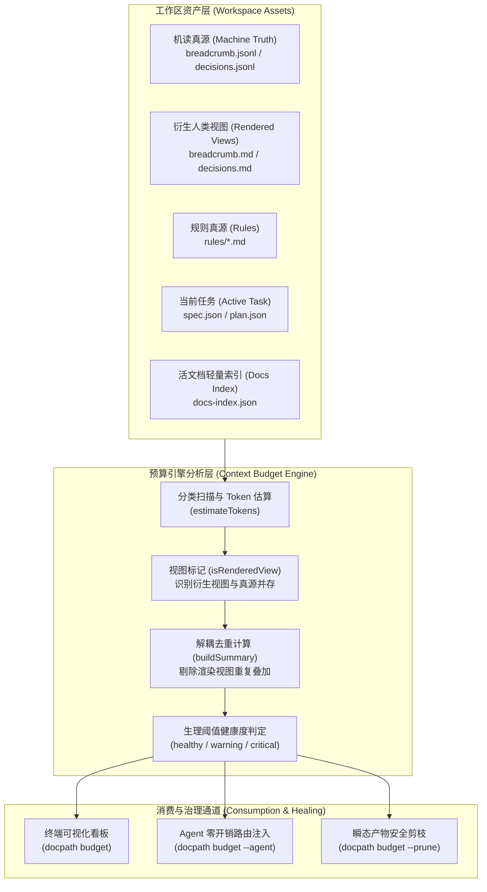

# 上下文 Token 预算透视与健康度治理引擎

## 1. 问题背景与动机 (Motivation)

在基于 LLM 的 Agent 协同研发体系中，上下文窗口（Context Window）不仅直接关系到 API 调用成本与吞吐性能，更直接决定了 Agent 的注意力质量与推理准确性。

早期实践中，DocPath 工作区随着事件与 ADR 积累，`docpath budget --agent` 频繁陷入 `status: critical` 的报警状态。深入分析后发现该问题根源在于预算计算引擎的两大设计缺陷：
1. **统计双计（Double Counting）**：
   `AGENTS.md` 明确声明：“*JSON/JSONL are machine truth; Markdown files are rendered human views and never default agent inputs*”。然而原有预算引擎简单地将 `.docpath/workspace/breadcrumb.jsonl`（机读事件真源，~12k tokens）与衍生渲染的人类视图 `breadcrumb.md`（~16k tokens）、`decisions.jsonl` 与 `decisions.md` 叠加相加，导致同一批历史轨迹被双重统计，虚高近 100%。
2. **静态阈值脱离生理容量**：
   原有阈值假定过于严苛（例如 events 分类上限仅 3,500 tokens），而真实项目中保持 200 条紧凑事件流天然需要约 12,000 tokens。过低的阈值导致工作区在完全健康合规的情况下持续误报 `critical`，使开发者与 Agent 产生报警疲劳。

## 2. 核心架构与解耦机制 (Architecture & Decoupling)

### 2.1 机读真源与渲染视图双计解耦

在 `src/utils/budget.ts` 中，`BudgetItem` 引入了 `isRenderedView?: boolean` 属性：
- 当 `events` 目录中同时存在 `breadcrumb.jsonl` 与 `breadcrumb.md` 时，将 `breadcrumb.md` 标记为 `isRenderedView = true`；
- 当 `governance` 目录中同时存在 `decisions.jsonl` 与 `decisions.md` 时，将 `decisions.md` 标记为 `isRenderedView = true`；
- 在 `buildSummary` 计算分类的 `totalTokens` 与全局健康度评级时，过滤掉带有 `isRenderedView` 标记的衍生视图，仅以机读真源作为 Agent 实际注入 Token 依据。

在终端看板的 Top 消耗源列表中，被标记的衍生视图会显式追加 `[渲染视图]` 标识，既保持了排查透视的透明度，又根除了虚假双计。

### 2.2 生理配额阈值自愈 (Physiological Thresholds)

根据真实项目的自然容量基线，对各模块的 Token 容限进行了科学校准：

| 模块分类 (Category) | 真实资产形态 | 推荐单文件阈值 | 推荐分类总阈值 | 设计依据 |
| :--- | :--- | :--- | :--- | :--- |
| **Rules** | 2 篇核心规则（style / architecture） | 8,000 | 16,000 | 单篇严格受 200 行上限约束，2 篇天然约 10k tokens |
| **Active Task** | spec.json / plan.json / wip-note | 3,000 | 6,000 | 活跃任务的紧凑结构化状态，轻量可控 |
| **Governance** | decisions.jsonl (ADR 归档) | 8,000 | 12,000 | 支持沉淀 30+ 条项目架构决策与反腐共识 |
| **Events** | breadcrumb.jsonl (历史轨迹) | 15,000 | 18,000 | 容纳 200 条上限的紧凑事件审计流 (~12k tokens) |
| **Views / Index**| docs-index.json / current.md | 2,000 (view) / 100,000 (index) | 110,000 | 活文档轻量索引已剔除内部切片，常态约 90k tokens |
| **Docs** | docs/ 核心活文档 | 4,000 | 20,000 | 支持按需 Reveal 注入局部高质量设计参考 |

## 3. 瞬态产物安全剪枝 (Pruning Mechanism)

当工作区历史轨迹过多或决策跨度过长时，开发者或 Agent 可执行 `docpath budget --prune`：
- 保留 `breadcrumb.jsonl` 最近的 200 条活跃事件，归档或精简冗余历史；
- 刷新 `current.md` 与人类视图；
- 清理孤立瞬态上下文切片，实现上下文自我净化。

## 4. 验证与质量保证 (Verification)

本机制通过以下体系提供 100% 确定性保证：
1. **单元测试与防回归保障**：
   [`tests/budget-command.test.mjs`](file:///Users/mac/project/docpath/tests/budget-command.test.mjs) 覆盖：
   - 终端图表与百分比看板渲染；
   - `--agent` YAML 输出与 `--json` 格式契约；
   - `--prune` 瞬态产物安全剪枝；
   - `decouples rendered views from machine truth to prevent double counting in budget` 解耦验证。
2. **全景健康度巡检**：
   - `docpath budget --agent` 评定为 `status: healthy`，所有子项全绿；
   - `docpath doctor --rules` 0 警告；
   - `docpath docs doctor` 10 项全绿。
