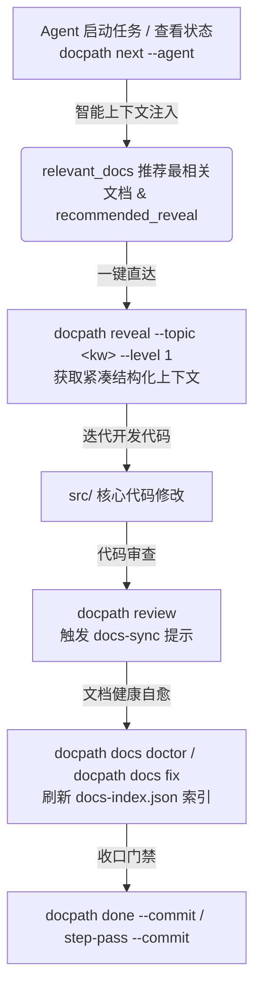

# DocPath 活文档防腐与 Agent 协议联动系统

## 1. 问题背景与动机 (Motivation)

在传统软件研发与 AI Agent 协同开发中，文档与代码经常面临以下痛点：
1. **文档腐化与脱节**：代码迭代频繁，但活文档（如架构说明、模块设计、API 契约）常常遗漏同步，导致新加入的 Agent 或工程师被过时文档误导。
2. **上下文检索成本高**：Agent 在启动任务或执行步骤时，若缺乏针对性的上下文指引，容易进行全仓大范围漫游检索，浪费 Context Token 并引入噪声。
3. **缺乏主动同步闭环**：代码审查阶段没有对“核心代码变动却未改动文档”进行结构化提示。

## 2. 核心联动架构 (Architecture)

DocPath 建立了从“上下文发现”到“审查提醒”再到“一键直达”的活文档联动闭环：



### 2.1 智能上下文推荐 (`relevant_docs`)
在 `docpath next --agent` 和 `docpath status --agent` 输出中，基于当前任务标题、Backlog 关键词及步骤需求，自动计算匹配度最高的活文档（最多 2 条），并直接提供 `recommended_reveal` 命令，使 Agent 零认知负荷获取相关知识。

### 2.2 Review 代码与文档同步提醒 (`[docs-sync]`)
在执行 `docpath review` 时，如果检测到核心代码变更（`src/` 或 `lib/`）且项目存在 `docs/` 资产但当前变更未包含 `docs/`，审查引擎将生成一条 `severity: 'info'` 的 `[docs-sync]` 提示，提醒 Agent 按照 `AGENTS.md` 规范同步更新活文档。

### 2.3 一键 Reveal 直达 (`recommended_reveal`)
在 `docpath doc <kw>` 或 `docpath docs search <kw>` 检索结果中，终端与 `--agent` 视图均附带一键直达指令：
```bash
docpath reveal --topic "<keyword>" --level 1
```
配合 Token 预算机制（`--max-tokens 2000`），实现高密度信息的高效注入。

## 3. 验证与门禁 (Verification)
- **单元与集成测试**: `tests/doc-command-enhanced.test.mjs`、`tests/docs-lint-command.test.mjs`、`tests/docs-sync.test.mjs`。
- **文档健康自愈**: `docpath docs fix` 自动检测并修复 frontmatter、标题与死链。
