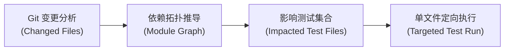

---
related:
  - guides/multi-stack-testing-efficiency.md
  - features/architecture-guard.md
---

# 测试影响分析与智能门禁加速体系 (Test Impact Analysis & Smart Gates)

> DocPath 测试与门禁效能体系旨在彻底解决 AI 辅助编程中的**“全量测试泛滥”、“反复多余构建”与“假绿假红误报”**问题。
> 建立“调试期定向精准测试 + 收口期单次全量原子门禁”的高效闭环。

---

## 1. 核心问题与设计原则

在多轮迭代编码与 Agent 协作过程中，传统的门禁方式存在三大痛点：
1. **调试期跑全量导致严重超时**：每次修改几行代码就运行全量测试套件（如 `pnpm test` / `cargo test`），消耗几分钟时间并耗尽 Agent 上下文。
2. **构建感知滞后**：修改源码后直接运行测试，测试加载的是旧产物，导致修改无效或虚假排查。
3. **收口冗余**：开发完成时手工执行一次 `check`，收尾命令又执行一次 `check`，造成双倍等待。

### DocPath 的解决方案：
- **原则 1：调试期严禁全量测试**：只允许运行与当前修改模块直接相关的单文件定向测试。
- **原则 2：构建感知自愈 (Build-Aware Healing)**：步骤验证引擎自动比对源码与构建产物的 `mtime`，源码更新时自动增量构建，无需手动插拔 `npm run build`。
- **原则 3：终步原子收口 (Single-Pass Atomic Closeout)**：全量测试只在收口时跑一次，由 `docpath step-pass --commit` 或 `docpath done --commit` 原子串联（check → review → journal → git commit）。

---

## 2. 测试影响分析 (Test Impact Analysis / TIA)

DocPath 内建基于变更集（Git Dirty Files）与模块拓扑的测试影响推导：

### 影响范围识别算法：
1. **直接关联**：修改 `src/commands/backlog.ts` 时，直接推导关联 `tests/backlog.test.mjs`。
2. **传递依赖**：修改 `src/engine/backlog.ts` 时，逆向遍历导入图，提取所有依赖该引擎的测试用例。
3. **单向过滤**：非代码文件（如 `.md`, `.json`, `.yaml` 资产）自动豁免单元测试运行，避免无意义的编译开销。

---

## 3. 多技术栈定向调试模式

在任务执行阶段（`executing`），各技术栈标准调试命令如下：

| 技术栈 | 调试期单文件定向命令 (开发中只跑这个) | 收口期全量门禁命令 (收工时只跑一次) |
|---|---|---|
| **Node / TypeScript** | `pnpm run build && node --test tests/<target>.test.mjs` | `docpath step-pass --commit` |
| **Rust / Cargo** | `cargo test -p <pkg> --test <name> -- <case>` | `docpath done --commit` |
| **Go** | `go test -v -run <TestFunction> ./pkg/...` | `docpath step-pass --commit` |
| **Python / Pytest** | `pytest tests/test_<target>.py -k "<case>"` | `docpath done --commit` |
| **Java / Gradle** | `./gradlew test --tests "com.example.TargetTest"` | `docpath step-pass --commit` |

---

## 4. 复合收口指令 (Compound Closeout Commands)

DocPath 提供了全自动原子收口命令，一次性完成门禁、审查、回填与提交：

### 4.1 `docpath step-pass --commit`
- **定位**：步骤收尾与自动推进。
- **行为**：
  - 若为中间步骤（如 S1/S2）：记录步骤通过事件（Breadcrumb），自动流转到下一步（S2/S3）。
  - 若为最终步骤（如 S3/S3）：自动执行全量质量检查（`check`）、代码规范审查（`review`）、知识经验归档（`journal`），并自动创建 Git 提交。

### 4.2 `docpath done --commit`
- **定位**：任务整体一键闭环。
- **行为**：无需按步骤推进，直接触发完整门禁序列并自动提交。

### 4.3 `docpath quick-done --commit`
- **定位**：轻量任务（Level 1）极速收口。
- **行为**：跳过冗长交互审查，直接执行必要静态门禁并一键提交。

---

## 5. 常见反模式与防范守则

> [!CAUTION]
> 1. **严禁手动勾选 spec.md 中的 `[x] AC-*`**：AC 是静态需求契约声明，执行进度完全由 `plan.md` 和 `docpath step-pass` 驱动，任何手动打勾脚本均属违规。
> 2. **严禁在收口前后重复执行 `docpath check`**：`step-pass --commit` 已内建检查，手动重复执行只会浪费时间与算力。
> 3. **连续 2 次环境/Harness 失败必须立即停下排查**：不要在环境错误上反复盲目重试。
