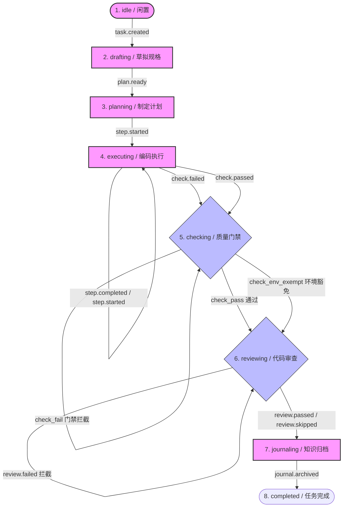

---
related:
  - getting-started.md
  - architecture/documentation-lifecycle-guide.md
---

# DocPath 产品全景文档 (Product Panorama)

> **💡 阅读指引**
>
> **这份文档的目的是：让任何没有写过代码的新同事，在 30 分钟内完全理解 DocPath 这个产品到底有哪些功能、每个功能在整体中处于什么位置、一个功能和另一个功能如何协同。**
>
> 无论是新入职的工程师、产品经理、设计、运营，还是需要对外介绍 DocPath、撰写文案的同事，都可以将本文作为 Onboarding 和了解产品事实的权威事实基础。本文的所有描述均可在代码、数据 Schema 或 API 中找到直接对应，不含虚浮的营销话术。

---

## 1. 什么是 DocPath？

### 1.1 产品定位
* **一句话定义**：**DocPath 是面向多人 / 多 Agent 开发团队的 AI 工作流状态层。**
* **核心承诺**：让开发团队（人类和 AI 协同）清晰知道**“任务现在在哪里、谁该接手、能不能继续推进、出了问题怎么安全恢复”**。
* **协作位置**：DocPath 并不是一个独立的开发工具，也不去替代 AI Agent 的推理。它充当底层设施，在 AI 编程环境（如 Claude Code, OpenCode, Codex, Aider 等）与实际项目代码库之间提供一个共享的**工作流、记忆和验证基座**。

```text
┌─────────────────────────────────────────────────────────────┐
│    AI 编程助手 (Claude Code / OpenCode / Codex / Aider)      │
└──────────────────────────────┬──────────────────────────────┘
                               │ 驱动与读取
                               ▼
┌─────────────────────────────────────────────────────────────┐
│                     DocPath 代理适配层                       │
│      (CLAUDE.md / AGENTS.md / AI 技能 / 命令行工具)          │
└──────────────────────────────┬──────────────────────────────┘
                               │ 写入与校验
                               ▼
┌─────────────────────────────────────────────────────────────┐
│                   项目本地状态与验证层 (.docpath/)           │
│   (状态机 FSM / 需求池 Backlog / 任务证据 Tasks / 质量门禁)   │
└─────────────────────────────────────────────────────────────┘
```

### 1.2 核心设计哲学
* **文档即状态机 (Document as FSM)**：在 DocPath 中，文档（如计划、规格书、面包屑日志）不仅是写给人类看的静态记录，它们更是工作流状态转换的真实数据源和硬性约束条件。
* **产品核心公式**：
  $$\text{DocPath} = \text{Superpowers 式门禁纪律} + \text{Trellis 式项目记忆} + \text{GSD 式状态编排}$$

---

## 2. DocPath 的三层工作模型

DocPath 通过三个相互协作的“功能图层”，规范并支撑 AI 团队的日常开发：

### 2.1 纪律层 (Discipline Layer) — 确保质量合规
* **回答的问题**：“AI 允许继续往下修改代码吗？”
* **核心职责**：
  * **测试前置 (TDD Aware)**：在行为变更的编码前，要求声明测试策略，提倡先写失败的测试。
  * **硬性门禁 (Quality Gates)**：在任务标记完成前，强制执行本地静态检查（`check`）和代码审查（`review`）。
  * **证据为凭**：拒绝任何没有测试运行日志或审查通过记录的“已修复”声称。
* **主要入口**：`docpath check`（质量门禁）、`docpath review`（代码审查）。

### 2.2 记忆层 (Spec Memory Layer) — 固化项目知识
* **回答的问题**：“项目在不同会话、不同 Agent 之间需要记住什么？”
* **核心职责**：
  * **知识沉淀**：将每次任务的最终决策和踩坑教训归档，供后续会话复用。
  * **防止漂移**：记录架构决策 (ADR) 供后续会话参考，减少重复争论已定设计点的风险。
  * **轻量上下文**：提供按主题过滤的局部上下文检索，而不是将整个代码库或所有文档暴力塞入 AI 的上下文窗口。
* **主要入口**：`docpath docs`（索引文档）、`docpath reveal` / `docpath context`（上下文提取）、`docpath journal`（知识归档）。

### 2.3 任务状态编排层 (Context & Orchestration Layer) — 导航与接力
* **回答的问题**：“开发现在处于什么阶段，下一步该做什么，断线后如何恢复？”
* **核心职责**：
  * **状态追踪**：维护项目当前的开发阶段，提供明确的下一步动作指引。
  * **面包屑足迹 (Breadcrumbs)**：记录精细的步骤执行痕迹，若 AI 运行中断或 Token 耗尽，新会话可秒级无缝恢复。
  * **无缝交接 (Handoff)**：在会话或人员交接时，生成包含“剩余风险”、“修改范围”和“交接摘要”的交接包。
* **主要入口**：`docpath next --agent`（路由建议）、`docpath go --step <id>`（步骤认领）、`docpath agent handoff`（交接归档）。

---

## 3. 双层状态机系统：Backlog 层 与 Task 执行层

DocPath 将项目管理分为两个维度：**水平的需求管理（Backlog 层）** 与 **垂直的任务执行（Task 执行层）**。它们各自拥有独立的状态机，但又通过“提升 (Promote)”与“归档 (Archive)”紧密相扣。

### 3.1 水平维度：需求管理 (Backlog 层)
用于回答**“我们有哪些待办需求、优先级如何、下一个该开发哪条、需求之间有什么依赖关系”**。

* **实体标识**：`R-###` (例如 `R-010`，每条需求独立为一个 Markdown 文件，存放在 `.docpath/backlog/` 下)。
* **状态机转移**：
  $$\text{proposed (已草拟)} \longleftrightarrow \text{accepted (已接受)} \longleftrightarrow \text{planned (已排期)} \longrightarrow \text{active (开发中)} \longrightarrow \text{done (已完成) / dropped (已废弃)}$$
* **核心能力图景**：
  1. **捕获与快速录入 (Capture & Add)**：`docpath backlog capture` 录入原始灵感（raw），`docpath backlog add` 直接录入具备背景与验收条件的就绪需求。
  2. **四段式规整与编辑 (Shape & Edit)**：`docpath backlog shape` 规范化为背景、功能要点、AC 验收、约束边界四段式模版；`docpath backlog edit` 支持修改状态、优先级、Kind、关联依赖及批量操作。
  3. **依赖拓扑与卡点分析 (Graph & Stats)**：`docpath backlog graph` 实时渲染依赖拓扑（ASCII / Mermaid）；`docpath backlog stats` 全景度量需求池漏斗、关键路径 (Critical Path) 与核心卡点 (Top Blockers)。
  4. **全生命周期检索 (Search & Show)**：`docpath backlog search` 支持跨 active/archived 多维度关键词过滤；`docpath backlog show` 聚合完整证据链。
  5. **自动化巡检与自愈治理 (Groom & Auto-Heal)**：`docpath backlog groom --fix` 一键巡检并修复悬空依赖、循环引用与同内容冗余副本。
  6. **提升与旁路闭环 (Promote & Done)**：`docpath backlog promote` 激活需求并派生任务目录；`docpath backlog done` 支持带 `--task` 证据的旁路完成，终态条目自动归档至 `archived/`。
  7. **索引毫秒级自愈**：`docpath check` 自动感知需求条目更新，当 `backlog.md` 索引落后时毫秒级自动重构自愈。

---

### 3.2 垂直维度：开发生命周期 (Task 执行层)
用于回答**“当前这个被认领的任务，如何从概念规格变成合格的代码与测试”**。

* **实体标识**：`T-YYYYMMDD-slug` (例如 `T-20260625-p2`)。在运行时，DocPath 会创建别名软链接 `.docpath/tasks/current/` 指向当前正在进行的任务目录，以保障执行的连续性。
* **生命周期阶段 (FSM Phase)**：
  DocPath 采用严格的**事件驱动状态转移机制**。开发必须按照阶段顺次流转，禁止跳过检查与审查：



#### 💡 状态与门禁事件速查表
| 发生事件 | 起始阶段 (Phase) | 目标阶段 (Phase) | 目标门禁状态 (Gate) | 触发命令 / 含义 |
| :--- | :--- | :--- | :--- | :--- |
| **`task.created`** | 任意 (除 executing) | `drafting` | `none` | `docpath write-spec`：任务创建并就绪 |
| **`plan.ready`** | `drafting` / `planning` | `planning` | `none` | `docpath write-plan`：执行计划编写完成 |
| **`step.started`** | `planning` / `executing` | `executing` | `none` | `docpath go --step <id>`：开始执行某一子步骤 |
| **`step.completed`**| `executing` / `checking` | `executing` | `none` | `docpath agent step --status done`：步骤完成 |
| **`check.passed`** | `executing` / `checking` | `checking` | `check_pass` | `docpath check`：编译/测试/Lint 全部通过 |
| **`check.failed`** | 任意 | `checking` | `check_fail` | `docpath check`：检测到编译或测试失败 |
| **`check.env_exempt`** | `planning` / `executing` / `checking` | `checking` | `check_env_exempt` | `docpath check`（R-350）：全部失败项均为**确定性可证**的工具链不可用 → 环境豁免，可继续评审/归档；`--no-env-exempt` 可关闭 |
| **`review.passed`** | `checking` / `reviewing` | `reviewing` | `review_pass` | `docpath review`：代码质量审查通过 |
| **`review.skipped`**| `checking` / `reviewing` | `reviewing` | `review_skipped`| `docpath review`：微型任务符合免审策略 |
| **`review.failed`** | 任意 | `reviewing` | `review_fail` | `docpath review`：审查发现问题，拦截归档 |
| **`journal.archived`**| 门禁通过状态 | `completed` | `review_pass` 等 | `docpath journal` / `agent done`：沉淀知识，任务逻辑结束 |

> [!IMPORTANT]
> **状态锁机制 (Lost Update Prevention)**：所有的读取、修改、写入状态的操作均在文件锁 `state.lock` 保护下串行执行，确保多个 Agent 会话（或人机并发）不会互相覆盖状态。

---

## 4. 目录结构与 Git 提交边界

### 4.1 `.docpath/` 物理目录树解析
DocPath 在项目根目录下建立 `.docpath/` 目录，其内部文件有明确的共享与隔离契约：

```text
.docpath/
├── config.yaml               # 项目级配置 (复杂度 level、质量规则等)
├── docs-index.json           # 项目内文档元数据索引
├── backlog/                  # 【共享】需求池
│   ├── R-010-backlog.md      # 需求原值
│   └── backlog.md            # 自动生成的待办汇总索引 (供人类和 AI 快速扫读)
├── rules/                    # 【共享】团队开发规范与 Agent 指令
│   ├── AGENTS.md             # DocPath Agent 核心交互协议
│   └── CLAUDE.md             # 针对 Claude Code 的定制指南
├── skills/                   # 【共享】可复用的 Agent 能力声明 (YAML Frontmatter + MD)
│   ├── docpath-workflow.md
│   └── docpath-tdd.md
├── workspace/                # 【隔离】单工作区/会话的临时运行态数据
│   ├── state.json            # 状态真值 (包含当前活跃任务ID、所处阶段、进行中的步骤)
│   ├── current.md            # 人类可见的当前状态渲染视图
│   ├── breadcrumb.jsonl      # 执行足迹 JSON 数据流 (每次命令的历史快照)
│   ├── breadcrumb.md         # 人类可见的执行进度图谱
│   ├── last-check.md         # 最近一次质量门禁的详细校验报告
│   └── decisions.md          # 本月新增的架构决策记录缓存 (ADR)
└── tasks/                    # 【隔离 / 历史共享】任务证据归档
    ├── current               # 软链接：指向当前正在执行的任务目录
    ├── T-20260625-p2/        # 任务物理目录真值
    │   ├── spec.md           # 任务规格书 (做什么，验收标准，决策 brief)
    │   ├── spec.json         # 规格结构化数据
    │   ├── plan.md           # 任务执行计划 (包含具体步骤 S1, S2...)
    │   ├── plan.json         # 执行计划结构化数据
    │   ├── check.md          # 任务专属检查报告
    │   └── review.md         # 任务专属审查报告
    └── done/                 # 历史已完成任务的物理归档区 (由 docpath gc 物理移动)
```

### 4.2 Git 提交边界 (Evidence Boundary)
为防止本地状态锁、临时报告、会话缓存污染公共 Git 仓库，DocPath 执行严格的**证据边界隔离原则**：

* **默认忽略**：在项目初始化时，整个 `.docpath/` 目录会被加入 `.gitignore`。
* **Changes 校验**：在提交代码（`git commit`）前，应运行：
  ```bash
  docpath changes --agent
  ```
* **精准追踪 (Force Add)**：DocPath 会分析本次开发修改了哪些任务，并在控制台输出需要强行加入 Git 的文件清单（即本次任务的**最终证据文件**）。团队只应 `git add -f` 这些被推荐的文件。
  * **✅ 允许进版本库的文件**：
    * 需求文件：`.docpath/backlog/R-###.md`
    * 任务证据：`.docpath/tasks/T-*/spec.md` 和 `plan.md`
  * **❌ 严禁进版本库的文件**（会被 `git status` 报错拦截）：
    * `.docpath/workspace/*`（锁、当前状态、临时缓存）
    * `.docpath/tasks/current/*`（软链接别名）
    * `.docpath/docs-index.json`（本地文档索引）

---

## 5. 两套执行流程：标准生命周期 与 快速收口通道

为了在“工程纪律”和“开发效率”之间取得完美平衡，DocPath 设计了重型和轻型两套任务模式：

### 5.1 标准生命周期 (Standard Profile)
* **适用场景**：涉及核心架构调整、数据协议修改、多文件复杂编写、CI/CD 或高风险重构的任务（对应配置 Level 2 与 Level 3）。
* **完整步骤流程**：

```text
 1. 提案 ──────>  2. 接受 ──────> 3. 激活 ──────> 4. 规格定义 ───> 5. 制定计划
  Capture        Accept        Promote       Write Spec      Write Plan
 (R-###草拟)    (验收背景明确)  (锁定为当前任务) (设计与决策)    (S1, S2 拆解)
                                                                    │
 8. 逻辑归档 <─── 7. 代码审查 <─── 6. 质量检查 <─── Go Step-by-Step <┘
   Journal         Review         Check         (认领并完成子步骤)
 (知识沉淀)       (变更逐文件扫) (测试构建全绿)
```

### 5.2 微型任务快车道 (Quick Profile)
* **适用场景**：修正注释错别字、单行 Bug 修复、低风险的配置文件微调等。
* **简化流程命令**：
  ```bash
  # 1. 快速创建并锁定一个微型任务 (自动跳过 Backlog 提案和 Spec/Plan 的撰写)
  docpath quick "修复 README 中的拼写错误"
  
  # 2. 正常修改你的代码文件...
  
  # 3. 运行一键收口 (自动触发 check 验证代码正确性，自动判定免除人工 review)
  docpath done
  ```
* **安全护栏**：若在 Quick 模式下修改了涉及架构文件、核心协议或修改文件数量过多，`docpath done` 的审计模块会强行报错拦截，要求开发者将其升级为标准任务重新补齐规格证据。

---

## 6. 团队交接与恢复机制 (Handoff & Continuity)

在多人协作或多个 Agent 会话交力同一个任务时，最容易出现“上下文丢失”和“状态断层”。DocPath 提供了可靠的交接与恢复协议。

### 6.1 责任交接 (Handoff)
当一个 Agent 运行结束（例如遭遇 Token 上限，或需要人类工程师接手）时，调用：
```bash
docpath agent handoff
```
该命令会收集当前未完结 of 进度，强制要求提供以下维度的交接包（Compact Context）：
* **下一步明确动作 (Next Steps)**：接班人需要立即运行的命令。
* **修改的文件清单 (Modified Files)**：已变更和未保存的范围。
* **剩余风险与阻塞点 (Risks & Blockers)**：尚未解决的代码隐患。
* **责任人变更记录 (Assignee Transfer)**：更新会话 Owner。

### 6.2 断线恢复与诊断
新接手人员或新 Agent 进入项目时，只需通过以下组合命令即可获得完整的恢复引导：
1. **查看下一步建议**：
   ```bash
   docpath next --agent
   ```
   它会读取 `workspace/state.json`，秒级给出当前任务的断点状态以及推荐的执行命令。
2. **诊断工作区健康度**：
   ```bash
   docpath doctor
   ```
   它会诊断工作区的 Git 状态是否干净、所有的软链接是否失效、是否存在并发修改冲突。

---

## 7. DocPath 核心命令矩阵 (Command Matrix)

| 阶段 / 目的 | 具体命令 | 图层归属 | 核心作用与输入输出 |
| :--- | :--- | :--- | :--- |
| **初始化与接入** | `docpath init` | 状态层 | 在项目内创建 `.docpath` 目录，注册项目至本地项目中心 |
| | `docpath install` | 适配层 | 为 Codex / Claude Code / OpenCode 写入适配文件和 Agent 协议 |
| **需求准备 (Backlog)** | `docpath backlog capture` | 状态层 | 快速捕获一个待办灵感 (`proposed`, raw) |
| | `docpath backlog add` | 状态层 | 录入结构化就绪需求 (`proposed`, shaped) |
| | `docpath backlog shape` | 状态层 | 将需求规整为四段式规范模版 |
| | `docpath backlog edit` | 状态层 | 编辑需求状态、优先级、Kind、依赖并支持批量修改 |
| | `docpath backlog search` | 记忆层 | 全生命周期跨活跃/归档需求全文过滤检索 |
| | `docpath backlog show` | 记忆层 | 查看单个需求条目详情与完整证据链 |
| | `docpath backlog stats` | 状态层 | 统计需求漏斗、依赖拓扑健康度与关键路径 |
| | `docpath backlog graph` | 状态层 | 渲染依赖拓扑图谱 (ASCII / Mermaid / Agent JSON) |
| | `docpath backlog groom` | 纪律层 | 巡检需求池健康度，`--fix` 一键自动治理修复 |
| | `docpath backlog promote` | 状态层 | 将需求提升为活跃任务 (`active`)，初始化 `tasks/current` 目录 |
| **开发设计** | `docpath write-spec` | 记忆层 | 将 Agent 当前澄清的规格方案写入 `spec.md` (触发 `task.created` 事件) |
| | `docpath write-plan` | 状态层 | 将拆解后的 S1/S2 步骤落盘到 `plan.md` (触发 `plan.ready` 事件) |
| **编码推进** | `docpath go --step <id>` | 状态层 | 原子化认领并启动某一子步骤，将步骤状态标记为 `executing` |
| | `docpath agent step` | 状态层 | 更新某一步骤的执行进度（完成、阻塞或跳过） |
| | `docpath step-pass --commit` | 编排层 | 步骤收尾原子推进：中间步骤自动流转，终步原子执行门禁并自动 Git 提交 |
| **任务隔离与切换** | `docpath task stash` | 编排层 | 热暂存当前活跃任务状态、文件与 Git 变更 |
| | `docpath task pop` | 编排层 | 恢复最近暂存的任务状态与上下文 |
| | `docpath task switch <id>` | 编排层 | 无缝切换任务：自动暂存当前任务并恢复目标任务 |
| | `docpath worktree create` | 编排层 | 创建 Git Worktree 独立隔离工作区进行多 Agent 并发开发 |
| **质量与收尾** | `docpath arch check` | 纪律层 | 架构分层单向依赖与 AST 循环引用防腐体检 |
| | `docpath check` | 纪律层 | 运行测试、构建与编译规则，输出 `last-check.md`，决定门禁通过或失败 |
| | `docpath review` | 纪律层 | 检查 Git 变更，对改动文件进行复杂度与质量审查，确认是否放行 |
| | `docpath journal` | 记忆层 | 将任务沉淀的 ADR 写入决策树，输出 Lesson 候选，标记状态为 `completed` |
| | `docpath done --commit` | 编排层 | 复合收口：一键原子执行 check → review → journal → git commit |
| | `docpath quick-done --commit` | 编排层 | 轻量任务极速收口：跳过冗长交互审查，一键门禁加提交 |
| | `docpath gc --force` | 状态层 | 将 `tasks/` 下已完成的任务物理归档到 `tasks/done/`，清理临时缓存 |
| **断点恢复与检索** | `docpath next --agent` | 编排层 | 只读获取当前断点状态、下一步指引及恢复命令提示 |
| | `docpath continue` | 编排层 | 提取最近执行日志和上下文摘要，辅助 Agent 恢复断线前记忆 |
| | `docpath reveal` | 记忆层 | 根据关键词渐进式披露项目背景，按需拉取知识以节省 Token |
| | `docpath docs doctor` | 记忆层 | 全景体检文档生态健康度（检查死链、未索引、空文档与陈旧索引） |

---

> [!NOTE]
> 以上文档汇总了 DocPath 作为一个“文档驱动的研发工作流底座”的全部功能事实。新入职的小伙伴可以对照此图景，配合命令行里的 `--help`，快速在开发中进行实践。如有任何模型转换、门禁逻辑的问题，可查阅对应的 [DocPath 代理规范协议](file:///Users/mac/project/docpath/AGENTS.md)。
